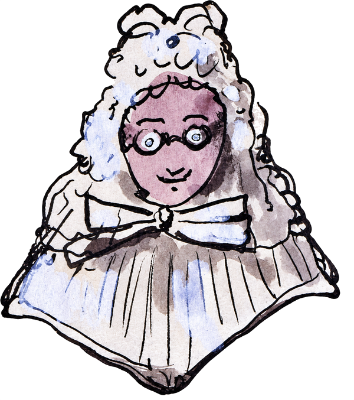

  

# Dottore

Dottore is a thesaurus of English, with German and some thirty other languages, built on an expanded model of Hegel's philosophical system. The idea comes from Roget, whose *Thesaurus* (1852) arranged words by the order of ideas rather than the alphabet. Roget's frame was a six-class map of everything that could be thought, inherited from Aristotle, Leibniz and Wilkins. Dottore keeps his method and his words and gives them a larger and stranger frame: the whole architecture of Hegel's Logic, Philosophy of Nature and Philosophy of Spirit. That frame is 1,056 entries deep, from Pure Being to the Hegelian System itself.

It is one web page, `editions/dottore.html` (with its logos beside it), online at **<https://gmleuning.github.io/dottore/editions/dottore.html>**. It needs no server and works offline, except for the dictionary panel.

## Using it

**Search.** Type a word or phrase, in English or German. Every entry that contains it is listed, with the matching lines highlighted. Entries whose headword matches come first, and the rest follow in the order of the system, so the list itself shows where the word lives: *light* turns up in Physics, in the feeling soul, in the religion of light and in the lightness of comedy. Above the results, a one-line list of entries (click ▸ to open it) jumps to each.

**Tips for good results:**

- Search whole words first. If nothing comes back, tick **partial words**, which matches inside words (*laugh* then finds *laughingstock*). Partial searches are slower, so they run when you press Enter.
- Accents don't matter: *naive* finds *naïve*, *Komodie* finds *Komödie*.
- Type a number to open that entry (*957* is Comedy), then step through its neighbours with the arrows at the top and bottom. The neighbours are the next concepts in Hegel's order, which is often the most useful way to read.
- By default only the matching lines of each entry show. Click **show full entry** under an entry, or tick **show full entries**, to see everything.
- **Alt**+click any word or phrase in an entry to search for it.
- Underlined numbers (*&c 816*) are cross-references to other entries, and can be clicked.
- `/` returns to the search box; `Esc` clears it or closes a side panel.

**Reading an entry.** Each entry has its number, its German and English heads, and its place in the system (the path line). Below come the words, grouped by part of speech (N., V., Adj., Adv.), then foreign words (F., one line per language, in their own scripts as well as in romanization), then phrases (Phr.). Each line is a group of near-synonyms, and the groups run gradually from the general to the particular. Tags in brackets mark register: [Coll.], [Slang], [Vulg.], [Brit.], [U.S.] and so on. A dagger (†) marks a word that is obsolete.

**The gloss.** Click a headword to reveal a short plain definition of the concept, in the style of the path line.

**The dictionary.** Double-click any word on the page to open it in a side panel from Wiktionary: its senses with examples, its pronunciation (IPA, and recordings you can play), and its etymology, drawn as a timeline from language to language. Links in the panel look up further words, or search the book for the one you are reading about.

**The Hegel panel.** Entries marked with a **Hegel** button open a second panel: Hegel's own definition of the concept, a few key passages from the works where he develops it, and a list of every place he treats it. Where Hegel numbered his text, locations are given by his numbers (§ for the *Encyclopaedia* and the *Philosophy of Right*, ¶ for the *Phenomenology*), which are the same in every edition; elsewhere by his chapter headings. This panel is new, and so far few entries have one.

**Settings.** The settings button opens a panel that remembers your choices in this browser:

- *Appearance:* light, dark or follow the system; accent colour; typeface, including a font of your own uploaded from your computer (kept in your browser); text size; line spacing; column width; which character the logo shows in light and in dark mode (by default il Dottore in light mode and Dialectica in dark mode, but either can be chosen for either).
- *Entries:* partial words, full entries, hiding obsolete words, glosses open by default, the path line on or off, how the list of results is shown (one expandable line, in full, or hidden), and which rows to show (for instance only nouns and foreign words).
- *Scripts:* for each language, show the original script, the romanization, or both.
- *Wiktionary:* double-click lookup on or off, IPA, audio, which languages to show and which to open first, how many examples per sense, and etymology as a timeline, as written, or hidden.

## Dialectica

  <picture>
    <source media="(prefers-color-scheme: dark)" srcset="editions/dottore_logo_white.svg">
    
  </picture>

In Martianus Capella's allegory *The Marriage of Philology and Mercury*, the Liberal Arts personified gather to attend the wedding of eloquence and erudition. Among the bridesmaids is *Dialectica*. She reminds the assembled that words are serpentine, sliding away from firm sentiments, set to change shape as quickly as context. She does this both by speaking simultaneously in sharp-cut phrases and murky pale, and by animating her metaphor with an enormous snake that strangled anyone too dim to understand her maneuvers. For Dialectica, the lines tracing between the words hold truth in its perfect black shine. Hegel took her name for the negative moment of thought, where what is reaches its surface, the outside, the other, and passes into relation.

*Il Dottore* is her wicked pair. He is the doctor of the commedia dell'arte, a pedantic Bolognese PhD, usually with a black gown, a wide collar, and a vocabulary as distended as his stomach. Whether Dottore Graziano, Baloardo, Balanzone, or just il Dottore, he speaks Dialectica's vernacular at a bent angle, busted Latin, etymological freestyling, accidental neologisms, and a cloud-cuckoo-land sophism. But between his words is the real void, illuminated by chains of drool, the soft nothing of nonsense. 

Dialectica's meaning in movement and Dottore's flowing nonsense, between the betweens is the Hegelian Architectonic. Brilliant, rigid, obtuse, triadomaniacal, eerily sensible, an intellectual acme of its time, bizarrely stupid in ours, Eurocentric in its best moments and plainly racist at its worst, infinitely inventive but always somehow sounding like a tired formula. 

Hegel's system has very few rivals for completeness, but the closer a system comes to completion, the more its rationality turns to delirium. Systems are comic, in Hegel's sense: self-negating untruths that are undone by their own confident unfolding. Confidence, completeness, insanity and comedy, the great system of the world hashes itself into oblivion in the space between Dialectica and il Dottore.

### Architectonics

The tree draws on the whole of Hegel's work, not only the *Encyclopaedia*'s outline:

- *Phenomenology of Spirit* (1807)
- *Science of Logic* (1812–1816)
- *Encyclopaedia of the Philosophical Sciences* (1817, 1827, 1830)
- *Elements of the Philosophy of Right* (1820)
- *Lectures on the Philosophy of World History*
- *Lectures on Aesthetics*
- *Lectures on the Philosophy of Religion*
- *Lectures on the History of Philosophy*

Its three parts are **Logic**, following the *Science of Logic*: Being, Essence, Concept. **Nature** follows the *Encyclopaedia*: Mechanics, Physics, Organics. **Spirit** runs from Subjective Spirit (soul, consciousness, mind) through Objective Spirit (right, morality, ethical life, the state and world history) to Absolute Spirit (art, religion, philosophy), with art, religion and philosophy filled out from the lectures.

### Editorial decisions

- **The History of Philosophy is cut down.** Hegel's lectures run from Thales to Schelling through hundreds of figures. To keep with the formal triadic and tetradic modeling of the system, they have been converted to four, Oriental, Greek, Medieval and Modern philosophy, with the Greeks in three stages and the moderns in scholastic triads of Rationalism (Descartes, Spinoza, Leibniz), Empiricism (Locke, Berkeley, Hume) and Critical Philosophy (Kant, Fichte, Schelling). 
- **Philosophy opens with the three syllogisms** with which the *Encyclopaedia* ends, Logic–Nature–Spirit and its two rotations, so the concept of philosophy is the circle of the system.
- **Hegel is the last entry.** Supposing the implicit terminus of his system, Hegel's own books are the telos of Philosophy, with his own triad of the *Phenomenology*, the *Logic*, and the *Encyclopaedia*, and the *Encyclopaedia* ending with its own recapitulation of Logic, Nature, and Spirit.

## Word sources

This thesaurus has 1,056 entries, with around 98,000 English words and phrases, and 6,500 in non-English languages.
- **Roget's *Thesaurus of English Words and Phrases*,** 1911 edition, in the Project Gutenberg digitization (eBook #10681, MICRA, 1991): the base vocabulary, its archaic and classical words, its Latin and French, its phrases, its cross-references and its register tags.
- **Open English WordNet** (2024 edition, CC BY 4.0): the kinds and varieties of things Roget never named.
- **`wordfreq`**: a check against the 30,000 commonest English words, so that ordinary words are not missing.
- **Contemporary English** added by hand: colloquial, slang and vulgar words, tagged by register. Slurs against groups of people are left out.
- **Hegel's German** for the heads and the German lines, and the technical vocabulary of his texts in English translation.
- **Foreign words** in 32 languages, chiefly Arabic, Latin, Chinese, Sanskrit, German, Japanese, Greek and French, with their original scripts.
- **Wiktionary** (CC BY-SA), consulted live by the dictionary panel and not stored in the book.

---
<h1 align="center">Doctor Ten-Times</h1>

<i>after Molière,</i> La Jalousie du Barbouillé<i>, scene 2</i>

**Flourish:** You look like an educated man, I'd like to ask you a question.

**Dottore:** First, you must not misprize me, I am not only educated, I am a doctor but not merely. I am a doctor one time, two times, three times, four times, five times, six times, seven times, eight times, nine times and ten times inclusive.

**Flourish:** Ah, indeed, the right person to speak...

**Dottore:**  I am a doctor one time over because the foundation of all knowledge is unity, the number of which is the one in its own self, that number is adscititiously known as the first of the numbers, meaning that I am the doctor in the first place and therefore placed first among doctors. Two times, because the essence of perfect and plenary knowledge is the sensorium and the understanding, and as a doctor of the first order, I must be undisplanted in all of the both of the two, thence I am a doctor two times.

**Flourish:** Yes, I see ...

**Dottore:** Third, being of the first, and the second as well, I am therefore doctor three times over, *syllogismos Barbara*. The number three is, as Aristotle says, νομβερο περφεκτα, the perfect number, perfection is defined as full wholeness, and therefore thrice a doctor, I am holyful.

**Flourish:** Okay, dear Dottore ...

**Dottore:** Four times must be most pellucidly obvious to you, philosophy has its four branches, that of logic, ethic, physic, and metaphysic, indoctorated in Philosophy as I am, I am thus four ways ramified and verified in each, four times a doctor.

**Flourish:** I don't doubt, and I concede the ten. Now if I could just ...

**Dottore:** How many universals are there?

**Flourish:** Universal whats?

**Dottore:** You see, if I am going to render myself qua crystal clear, we needs most palestric elaboration. Five, there are five universals: genus, species, difference, property, and accident. Without these it is impossible to know anything, neither haecceitly nor quidditly, and I happen to know for myself my all five. Genus: *Homo*, species: *Sapiens Sapiens*, difference: in degree (*Doctoratus in Philosophia*), property: rented apartment and borrowed shed, and accidentally: I am Bolognese.

**Flourish:** I relent, complete the set.

**Dottore:** In the holy books, man is assigned a digit, the digit six. My doctoring was studied precisely on these sapiens to the second *potenz*, hence doctor six times. Six is, according to Euclides, τέλειος ἀριθμός, the perfect number, perfection is defined as consummate totality. Therefore, I am totally consummated.

**Flourish:** I await whatever mystery comes next.

**Dottore:** Seven, there are seven ages of man. I myself am a man both *in propria persona* and *ad hominem*, conative and cognitive. Doctor eight, doctorate, and of course, the number eight is, according to Augustine Hipponites, the *numerus perfectionis*, the perfect number, where perfection is defined as void's immediacy. Therefore, I am immediately void. Nine times, because there are nine tenths of the law, and doctor ten times, because ten supervenes itself in itself, it cannot be acquired or arrived at without all the numbers that came before it, one, two, three, four, five, six, seven, eight, nine and ten too, hence, I am a doctor and a dicker of doctors. Like the tree of Porphyry, I contain them all once again. *Toto coelo, tutti culo*, I am one time, two times, three times, four times, five times, six times, seven times, eight times, nine times, and ten times a doctor.

**Flourish:** What in the hell is this? I wanted to talk to an educated man and instead I have to hear some bozo counting his As, Bs, and Cs. Are there any eleven-times doctors I can talk to?
