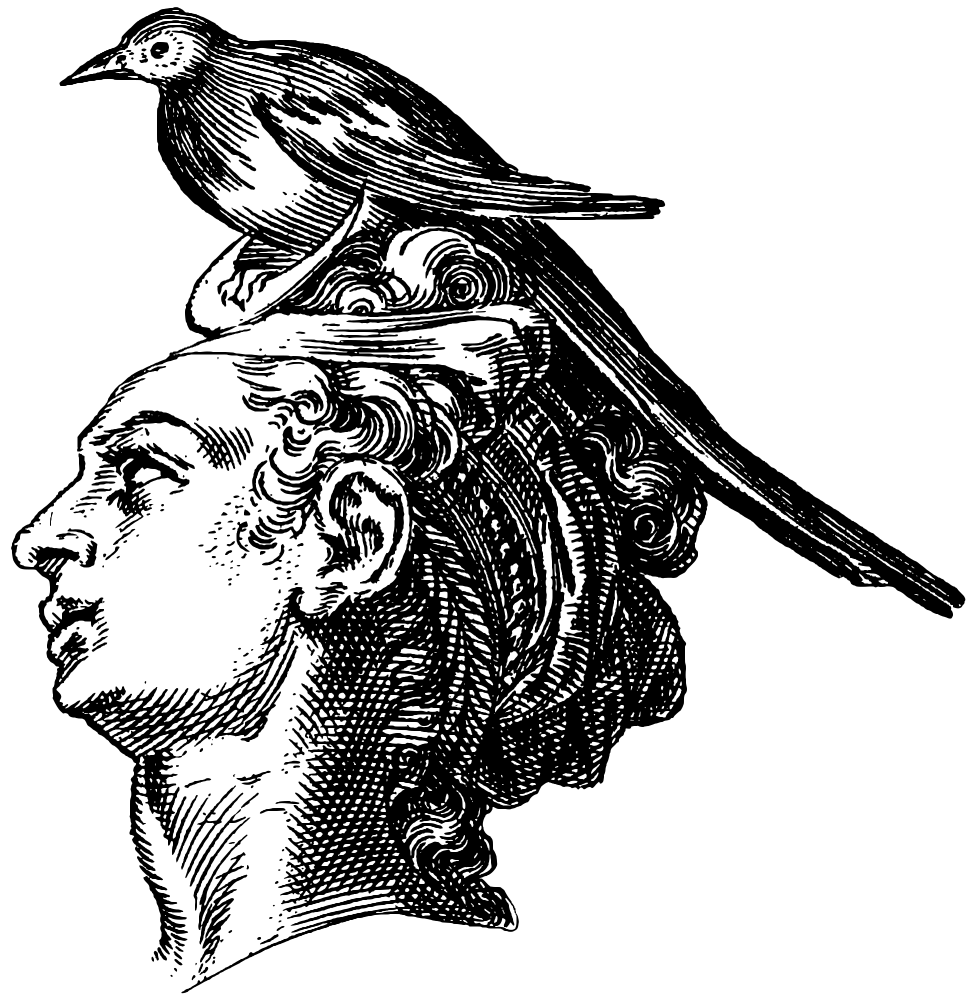
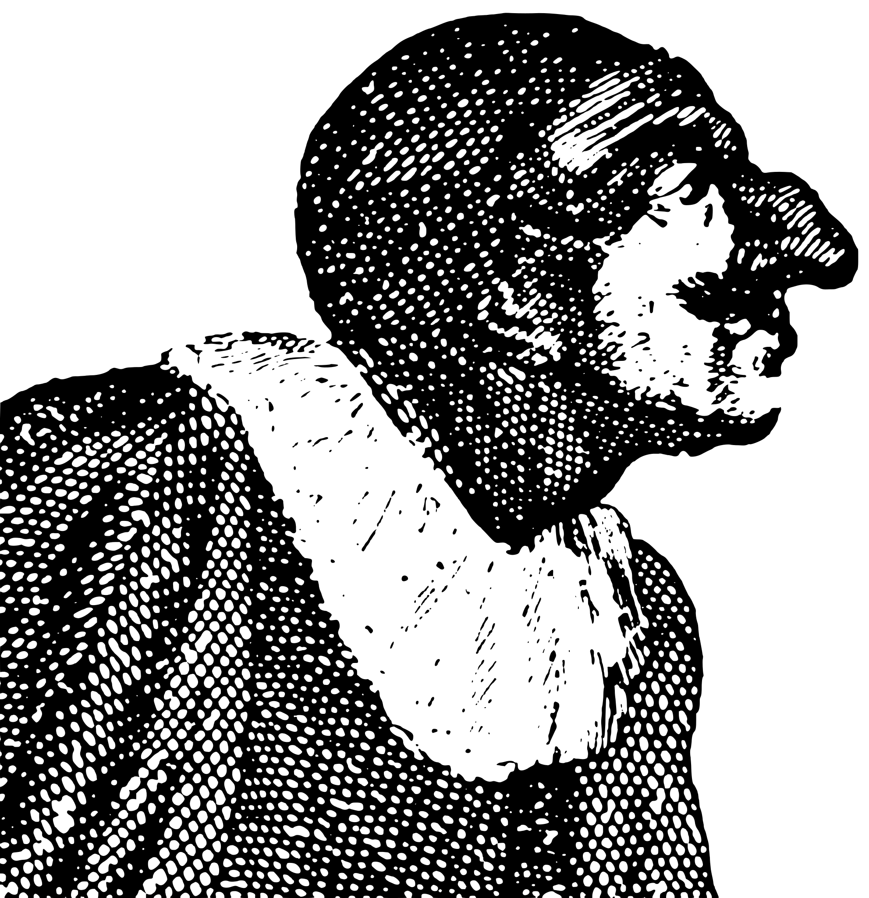

  
  &nbsp;&nbsp;&nbsp;&nbsp;
  

# Dottore

Dottore is a thesaurus of English, with German and some thirty other languages, built on an expanded model of Hegel's
philosophical system. The idea comes from Roget, whose *Thesaurus* (1852) arranged words by the order of ideas rather
than the alphabet. Roget's frame was a six-class map of everything that could be thought, inherited from Aristotle,
Leibniz and Wilkins. Dottore keeps his method and his words and gives them a larger and stranger frame: the whole
architecture of Hegel's Logic, Philosophy of Nature and Philosophy of Spirit. That frame is 1,056 entries deep, from
Pure Being to the Hegelian System itself.

It is one web page, `editions/dottore_3ed.html` (with `dottore_logo.svg` and `dottore_logo_dark.svg` beside it). It
needs no server and works offline, except for the dictionary panel.

## Using it

**Search.** Type a word or phrase, in English or German. Every entry that contains it is listed, with the matching lines
highlighted. Entries whose headword matches come first, and the rest follow in the order of the system, so the list
itself shows where the word lives: *light* turns up in Physics, in the feeling soul, in the religion of light and in the
lightness of comedy. Above the results, a one-line list of entries (click ▸ to open it) jumps to each.

**Tips for good results:**

- Search whole words first. If nothing comes back, tick **partial words**, which matches inside words (*laugh* then finds
  *laughingstock*).
- Accents don't matter: *naive* finds *naïve*, *Komodie* finds *Komödie*.
- Type a number to open that entry (*957* is Comedy), then step through its neighbours with the arrows at the top and
  bottom. The neighbours are the next concepts in Hegel's order, which is often the most useful way to read.
- By default only the matching lines of each entry show. Click **show full entry** under an entry, or tick
  **show full entries**, to see everything.
- **Alt**+click any word or phrase in an entry to search for it.
- Underlined numbers (*&c 816*) are cross-references to other entries, and can be clicked.
- `/` returns to the search box; `Esc` clears it or closes a side panel.

**Reading an entry.** Each entry has its number, its German and English heads, and its place in the system (the path
line). Below come the words, grouped by part of speech (N., V., Adj., Adv.), then foreign words (F., one line per
language, in their own scripts as well as in romanization), then phrases (Phr.). Each line is a group of near-synonyms,
and the groups run gradually from the general to the particular. Tags in brackets mark register: [Coll.], [Slang],
[Vulg.], [Brit.], [U.S.] and so on. A dagger (†) marks a word that is obsolete.

**The gloss.** Click a headword to reveal a short plain definition of the concept, in the style of the path line.

**The dictionary.** Double-click any word on the page to open it in a side panel from Wiktionary: its senses with
examples, its pronunciation (IPA, and recordings you can play), and its etymology, drawn as a timeline from language to
language. Links in the panel look up further words, or search the book for the one you are reading about.

**The Hegel panel.** Entries marked with a **Hegel** button open a second panel: Hegel's own definition of the concept,
a few key passages from the works where he develops it, and a list of every place he treats it. Where Hegel numbered
his text, locations are given by his numbers (§ for the *Encyclopaedia* and the *Philosophy of Right*, ¶ for the
*Phenomenology*), which are the same in every edition; elsewhere by his chapter headings. This panel is new, and so far
few entries have one.

**Settings.** The settings button opens a panel that remembers your choices in this browser:

- *Appearance:* light, dark or follow the system; accent colour; typeface; text size; line spacing; column width.
  In dark mode the logo changes from Dialectica to il Dottore.
- *Entries:* partial words, full entries, hiding obsolete words, glosses open by default, the path line on or off, how
  the list of results is shown (one expandable line, in full, or hidden), and which rows to show (for instance only
  nouns and foreign words).
- *Scripts:* for each language, show the original script, the romanization, or both.
- *Wiktionary:* double-click lookup on or off, IPA, audio, which languages to show and which to open first, how many
  examples per sense, and etymology as a timeline, as written, or hidden.

## The system

### Dialectica and il Dottore

The book has two faces, turned away from each other.

**Dialectica** is the art of argument as the ancients pictured her. In Martianus Capella's allegory *The Marriage of
Philology and Mercury*, the liberal arts come to the wedding of eloquence and learning as bridesmaids. Dialectica is
the sharp one: pale, quick-eyed, a serpent coiled half-hidden in one hand and hooks in the other, for catching an
opponent in his own words. Her art is to set one term against another until something comes out that neither held
alone. Hegel took the name for the movement of thought itself, in which every concept, pressed far enough, passes into
its opposite, and the truth is the whole path.

**Il Dottore** is that art's grotesque. He is the doctor of the commedia dell'arte, a Bolognese pedant in a black gown
and a vast collar, known as Graziano, Baloardo, and later Balanzone. He knows everything and understands nothing. He
cannot stop talking: a torrent of Latin tags, false etymologies, definitions and divisions, every word summoning three
more, the whole of learning poured out to answer a question nobody asked. He is the reason this book is named after him.

They are paired, and they are inversions of each other. Both are claims about how meaning comes from *between* words.
For Dialectica, meaning is the movement from one word to its other: the difference does the work. For the Dottore,
words pile up beside each other with no movement at all, and the meaning drains away into the sound of erudition. A
thesaurus is both at once. Each line is a heap of words that mean almost the same thing, and the sense is found only in
the slight differences between them, and in the passage from one line, and one entry, to the next.

### An ironic architecture

The frame is Hegel's system: archaic, overly rigid, frequently obtuse; astonishingly erudite for its time, and as
astonishingly ignorant from ours; Eurocentric at its best and racist at its worst. It ranks religions and peoples on a
ladder that ends in Protestant Prussia, and it puts whole continents outside history. None of that is endorsed here. The
system is used as an *ironic* architecture: a structure taken seriously enough to be filled to its last corner, and
exposed by being filled.

Any system of everything is an artifice. The more completely a system shows itself, the more surreal and delirious it
looks: galvanism a few hundred entries from grace, the syllogism on the way to the stomach, the farce and the Trinity in
the same book. That delirium is the point. A world with no genuine structure produces exactly this kind of manifest,
total, slightly mad order, and a book arranged this way is, for that reason, more adequate to it than a neutral
alphabet. The Dottore's tirade and Hegel's *Encyclopaedia* have more in common than either would like.

### How the system was built

The tree draws on the whole of Hegel's work, not only the *Encyclopaedia*'s outline:

- *Phenomenology of Spirit* (1807)
- *Science of Logic* (1812–1816)
- *Encyclopaedia of the Philosophical Sciences* (1817, 1827, 1830), with its Philosophy of Nature read through Petry's
  analytical tables
- *Elements of the Philosophy of Right* (1820)
- *Lectures on the Philosophy of World History*
- *Lectures on Aesthetics*
- *Lectures on the Philosophy of Religion*
- *Lectures on the History of Philosophy*

Its three parts are **Logic** (一), following the *Science of Logic*: Being, Essence, Concept. **Nature** (二) follows the
*Encyclopaedia*: Mechanics, Physics, Organics. **Spirit** (三) runs from Subjective Spirit (soul, consciousness, mind)
through Objective Spirit (right, morality, ethical life, the state and world history) to Absolute Spirit (art, religion,
philosophy), with art, religion and philosophy filled out from the lectures.

License was taken in several places:

- **The 1807 *Phenomenology* is folded into the system.** Its Consciousness and Self-Consciousness are merged with the
  *Encyclopaedia*'s, and the rest of the book (Reason, Spirit, Religion, Absolute Knowing) sits under Phenomenology ›
  Reason, so that its shapes of culture, conscience and the beautiful soul have a home.
- **Objective Spirit adds world history** from the lectures to the *Philosophy of Right*.
- **Fours where the material falls into four.** Hegel thinks in threes, but some of his material divides into four;
  those nodes are marked [Tetrad] and kept.
- **Editorial nodes.** Some headings are built for the thesaurus rather than taken from Hegel, mostly where his
  treatment is thin and the vocabulary is thick (feeling, morality, the passions).
- **Modernized names.** Old translations are replaced where a better rendering exists: "Conceptual" for "Notional",
  "Fraud" for "Deception".
- **Numbering.** The three parts carry no number; the levels below are numbered 1., I., α., a., i., 1. and so on, which
  marks depth, not meaning.

### Judgment calls

- **The History of Philosophy is cut down.** Hegel's lectures run from Thales to Schelling through hundreds of figures,
  with long dismissive stretches on Chinese and Indian thought. Here they are reduced to a frame of four: Oriental,
  Greek, Medieval and Modern philosophy, with the Greeks in three stages and the moderns in the schoolroom triads of
  Rationalism (Descartes, Spinoza, Leibniz), Empiricism (Locke, Berkeley, Hume) and Critical Philosophy (Kant, Fichte,
  Schelling). It is a simplification, and an honest one: a thesaurus needs the shape, not the lecture.
- **Philosophy opens with the three syllogisms** with which the *Encyclopaedia* ends, Logic–Nature–Spirit and its two
  rotations, so the concept of philosophy is the circle of the system.
- **Hegel is the last entry.** After Kant, Fichte and Schelling, the history of philosophy arrives at the Hegelian
  System: the *Phenomenology*, the *Logic*, and the *Encyclopaedia*, whose three parts point back to Logic, Nature and
  Spirit at the start of the book. The system ends by containing itself, as Hegel's does, and the book is circular by
  design. Whether that is the triumph of reason or the Dottore's last word is left to the reader.

## Sources of the words

- **Roget's *Thesaurus of English Words and Phrases*,** 1911 edition, in the Project Gutenberg digitization (eBook
  #10681, MICRA, 1991): the base vocabulary, its archaic and classical words, its Latin and French, its phrases, its
  cross-references and its register tags.
- **Open English WordNet** (2024 edition, CC BY 4.0): the kinds and varieties of things Roget never named.
- **English word frequency** (the `wordfreq` lists): a check against the 30,000 commonest English words, so that
  ordinary words are not missing.
- **Contemporary English** added by hand: colloquial, slang and vulgar words, tagged by register. Slurs against groups
  of people are left out.
- **Hegel's German** for the heads and the German lines, and the technical vocabulary of his texts in English
  translation.
- **Foreign words** in 32 languages, chiefly Arabic, Latin, Chinese, Sanskrit, German, Japanese, Greek and French, with
  their original scripts.
- **Wiktionary** (CC BY-SA), consulted live by the dictionary panel and not stored in the book.

In all: 1,056 entries, about 98,000 English words and phrases, and some 6,500 foreign ones. How the book is edited and
built is described in [docs/making.md](docs/making.md).

---

> **Le Docteur.** Sache auparavant que je ne suis pas seulement une fois docteur, mais que je suis une, deux, trois,
> quatre, cinq, six, sept, huit, neuf et dix fois docteur : 1° parce que, comme l'unité est la base, le fondement et le
> premier de tous les nombres, aussi, moi, je suis le premier de tous les docteurs, le docte des doctes ; 2° parce qu'il
> y a deux facultés nécessaires pour la parfaite connoissance de toutes choses, le sens et l'entendement ; et, comme je
> suis tout sens et tout entendement, je suis deux fois docteur.
>
> **Le Barbouillé.** D'accord. C'est que…
>
> **Le Docteur.** 3° Parce que le nombre de trois est celui de la perfection, selon Aristote ; et, comme je suis parfait,
> et que toutes mes productions le sont aussi, je suis trois fois docteur.
>
> **Le Barbouillé.** Eh bien, monsieur le docteur…
>
> **Le Docteur.** 4° Parce que la philosophie a quatre parties, la logique, la morale, la physique et la métaphysique ;
> et, comme je les possède toutes quatre, et que je suis parfaitement versé en icelles, je suis quatre fois docteur.
>
> **Le Barbouillé.** Que diable, je n'en doute pas. Écoutez-moi donc.
>
> **Le Docteur.** 5° Parce qu'il y a cinq universaux, le genre, l'espèce, la différence, le propre et l'accident, sans la
> connoissance desquels il est impossible de faire aucun bon raisonnement ; et, comme je m'en sers avec avantage, et que
> j'en connois l'utilité, je suis cinq fois docteur.
>
> **Le Barbouillé.** Il faut que j'aie bonne patience.
>
> **Le Docteur.** 6° Parce que le nombre de six est le nombre du travail ; et, comme je travaille incessamment pour ma
> gloire, je suis six fois docteur.
>
> **Le Barbouillé.** Ho ! parle tant que tu voudras !
>
> **Le Docteur.** 7° Parce que le nombre de sept est le nombre de la félicité ; et, comme je possède une parfaite
> connoissance de tout ce qui peut rendre heureux, et que je le suis en effet par mes talens, je me sens obligé de dire
> de moi-même : *O ter quaterque beatum !* 8° parce que le nombre de huit est le nombre de la justice à cause de
> l'égalité qui se rencontre en lui, et que la justice et la prudence avec lesquelles je mesure et pèse toutes mes
> actions me rendent huit fois docteur ; 9° parce qu'il y a neuf Muses, et que je suis également chéri d'elles ; 10°
> parce que, comme on ne peut passer le nombre de dix sans faire une répétition des autres nombres, et qu'il est le
> nombre universel, aussi, quand on m'a trouvé, on a trouvé le docteur universel, je contiens en moi tous les autres
> docteurs. Ainsi tu vois par des raisons plausibles, vraies, démonstratives et convaincantes, que je suis une, deux,
> trois, quatre, cinq, six, sept, huit, neuf, dix fois docteur.
>
> **Le Barbouillé.** Que diable est ceci ?

*Molière, La Jalousie du Barbouillé, scene 2 (c. 1660), a farce on the Italian model in which the Doctor is the
commedia's Dottore in French dress. Text from the Chasles edition (1888), via Wikisource.*

*"Know first that I am not just once a doctor, but one, two, three … ten times a doctor: first, because as unity is the
base, foundation and first of all numbers, so I am the first of all doctors, the doctor of doctors … tenth, because as
one cannot pass the number ten without repeating the other numbers, and it is the universal number, so whoever has
found me has found the universal doctor: I contain in myself all other doctors."*
